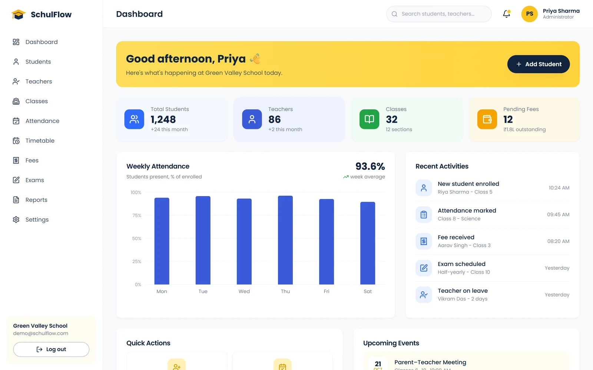
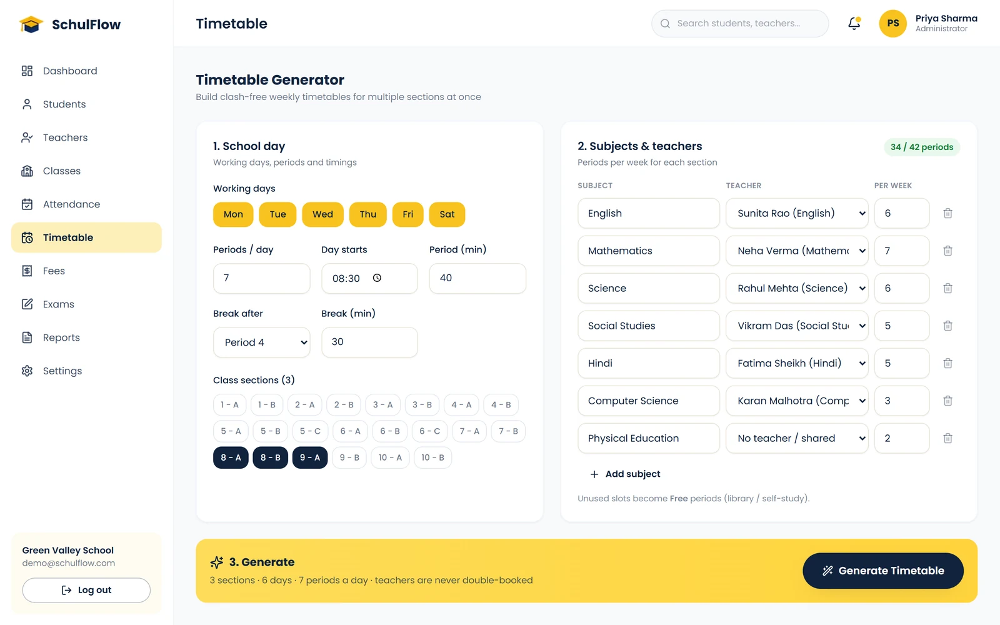
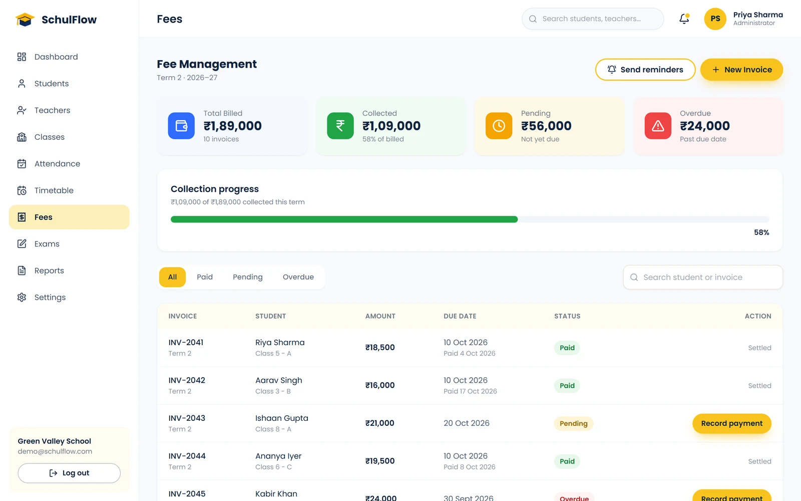

# SchulFlow — School Management System Template

A school management system with its own marketing website, built with React, Vite, Tailwind CSS and shadcn/ui. The website has a landing page, features, pricing, about and contact pages; behind a sign-in sits a dashboard for students, teachers, classes, attendance, a clash-free timetable generator, fees, exams, reports and settings.

**[Live demo](https://schulflow.codespanda.com/)** · **[Template page](https://codespanda.com/templates/schulflow)** · **[Documentation](https://codespanda.com/templates/schulflow/docs)**

Demo login: `demo@schulflow.com` / `demo1234`


## Features

**Website**

- Landing page with a live dashboard preview, a modules grid, operations and why-choose sections, testimonials and a call to action.
- Features page covering 12 modules, a pricing page with three plans and a monthly/yearly toggle, an about page and a contact form.
- Sign-up and log-in pages with a demo account.

**Dashboard**

- **Overview** — stat cards, weekly attendance chart, recent activity, quick actions and upcoming events.
- **Students and teachers** — searchable tables with status filters and an Add Student side panel.
- **Classes and attendance** — class sections and a daily roster to mark present, absent, late or on leave.
- **Timetable generator** — builds weekly timetables for several class sections at once so no teacher is ever double-booked.
- **Fees and exams** — invoices with collection progress and reminders, exam schedules and results.
- **Reports and settings** — fee and attendance analytics with CSV downloads, profile and school settings.



## Tech stack

- React 18 and JavaScript
- [Vite](https://vitejs.dev) 6
- [Tailwind CSS](https://tailwindcss.com) 3 and [shadcn/ui](https://ui.shadcn.com) (Radix)
- React Router 6
- [lucide-react](https://lucide.dev) icons

## Getting started

You need Node.js 20 or newer.

```bash
npm install
npm run dev
```

Open [http://localhost:5173](http://localhost:5173) and log in with the demo account above, or create your own.

| Command | What it does |
| --- | --- |
| `npm run dev` | Start the Vite dev server |
| `npm run build` | Build the production site into `dist/` |
| `npm run preview` | Serve the built `dist/` folder locally |

## Project structure

```text
src/
  pages/                 Home, Features, Pricing, About, Contact, Login, Signup, NotFound
    dashboard/           Overview, Students, Teachers, Classes, Attendance, Timetable,
                         Fees, Exams, Reports, Settings, ComingSoon
  components/
    sections/            Website sections: Header, Hero, Features, Operations, WhyChoose,
                         Testimonials, CallToAction, Footer
    dashboard/           DashboardLayout (sidebar and top bar), BarChart, shared UI
    ui/                  shadcn/ui primitives
  context/AuthContext.jsx  Signed-in user and route guards
  lib/
    auth.js              Mock auth service (localStorage) with the demo account
    timetable.js         The timetable generator
  data/school.js         Students, teachers, classes, invoices, exams, results, chart data
  App.jsx                Website, auth and dashboard routes
  index.css              Theme colors as CSS variables
tailwind.config.js       Tailwind theme
scripts/spa-routes.mjs   Writes a real page for every route on GitHub Pages
```

## Make it your own

- **Data** — `src/data/school.js` holds the sample students, teachers, classes, invoices, exams, results and chart data. Swap it for API calls when you connect a backend.
- **Sign-in** — `src/lib/auth.js` is a mock that keeps accounts in the browser's localStorage so the flow works without a server. Replace each function with a call to your API before going live, and never store real passwords in localStorage.
- **Timetable rules** — the generator lives in `src/lib/timetable.js`. It places lessons so a teacher is never in two places at once, keeps a subject to a few periods a day and spreads it across the week.
- **Pricing** — plans, prices and FAQs are in `src/pages/Pricing.jsx`.
- **Colors** — edit the CSS variables in `src/index.css` (the yellow brand is `--primary: 45 95% 55%`); `tailwind.config.js` maps them, together with the navy text color and fonts.
- **Title and description** — edit `index.html`.
- **Contact form** — it shows a confirmation but doesn't send anything yet. Connect it in `src/pages/Contact.jsx`.



## Deployment

`npm run build` writes a static site to `dist/`.

**GitHub Pages** — `.github/workflows/deploy.yml` builds and deploys on every push to `main`:

1. In the repository, open **Settings → Pages** and set **Source** to **GitHub Actions**.
2. Push to `main`. The workflow sets `VITE_BASE` from your Pages settings — `/` for a custom domain, `/<repo>/` for a github.io address.
3. After building, `scripts/spa-routes.mjs` writes a real `index.html` for every route plus a `404.html`, so refreshing `/dashboard/students` works. Keep its route list in sync with `App.jsx`.

**Netlify or Vercel** — `public/_redirects` and `vercel.json` already rewrite every route to `index.html`. Use build command `npm run build` and output folder `dist`.



## Credits

Designed and built by [CodesPanda](https://codespanda.com). Browse more free templates at [codespanda.com/templates](https://codespanda.com/templates).
